<!-- cool-readme:start -->
<!-- Cards by github-cool-readme: https://github.com/pedrocatalao/github-cool-readme -->

  <picture>
    <source media="(prefers-color-scheme: dark)" srcset="https://raw.githubusercontent.com/AbdullahAshfaq77/AbdullahAshfaq77/cards/about-dark.svg">
    
  </picture>
  <picture>
    <source media="(prefers-color-scheme: dark)" srcset="https://raw.githubusercontent.com/AbdullahAshfaq77/AbdullahAshfaq77/cards/languages-dark.svg">
    
  </picture>

  <picture>
    <source media="(prefers-color-scheme: dark)" srcset="https://raw.githubusercontent.com/AbdullahAshfaq77/AbdullahAshfaq77/cards/summary-dark.svg">
    
  </picture>
  <picture>
    <source media="(prefers-color-scheme: dark)" srcset="https://raw.githubusercontent.com/AbdullahAshfaq77/AbdullahAshfaq77/cards/contributions-dark.svg">
    
  </picture>

<!-- cool-readme:end -->
