<table width="100%">
  <tr>
    <td width="50%" valign="top">
      <picture>
        <source media="(prefers-color-scheme: dark)" srcset="https://raw.githubusercontent.com/AbdullahAshfaq77/AbdullahAshfaq77/cards/about-dark.svg">
        
      </picture>
    </td>
    <td width="50%" valign="top">
      <picture>
        <source media="(prefers-color-scheme: dark)" srcset="https://raw.githubusercontent.com/AbdullahAshfaq77/AbdullahAshfaq77/cards/languages-dark.svg">
        
      </picture>
    </td>
  </tr>
  <tr>
    <td width="50%" valign="top">
      <picture>
        <source media="(prefers-color-scheme: dark)" srcset="https://raw.githubusercontent.com/AbdullahAshfaq77/AbdullahAshfaq77/cards/summary-dark.svg">
        
      </picture>
    </td>
    <td width="50%" valign="top">
      <picture>
        <source media="(prefers-color-scheme: dark)" srcset="https://raw.githubusercontent.com/AbdullahAshfaq77/AbdullahAshfaq77/cards/weekly-dark.svg">
        
      </picture>
    </td>
  </tr>
</table>
